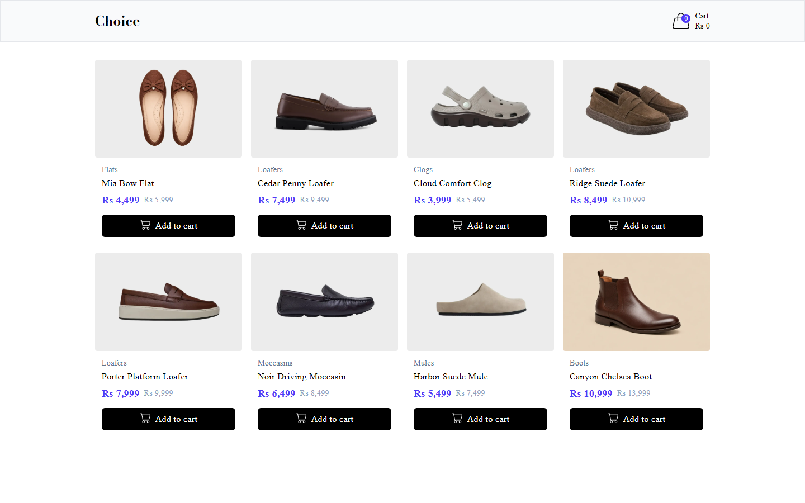
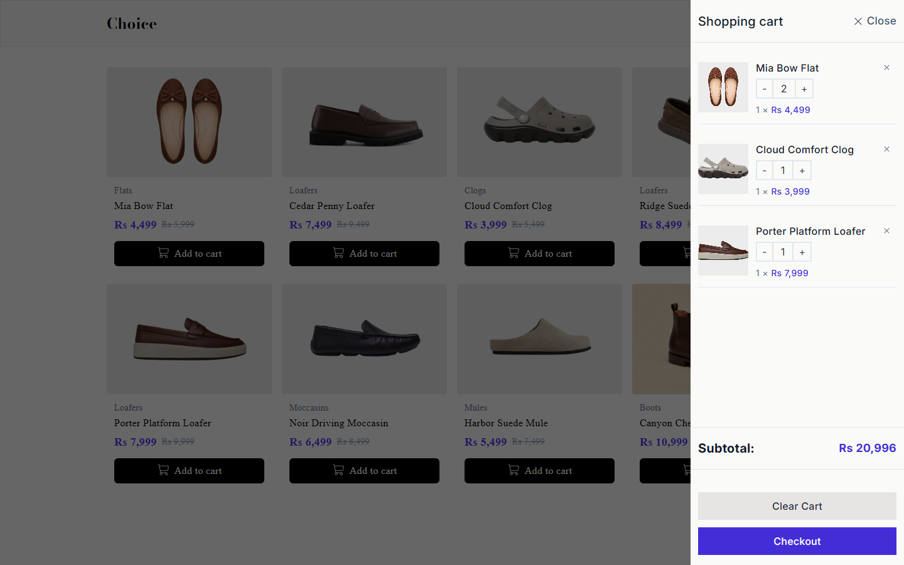
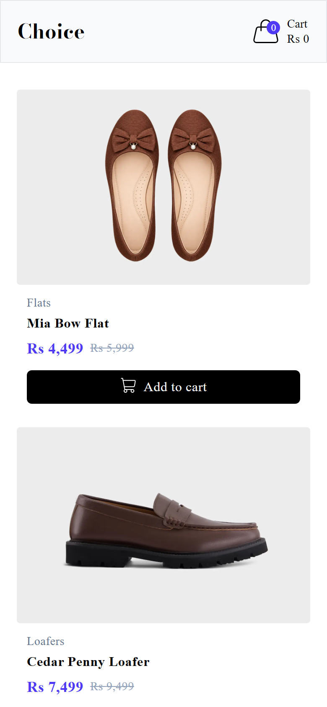

# Choice — React Shopping Cart

A fast, responsive e-commerce storefront with a slide-in shopping cart, built with **React 19**, **Vite** and **Tailwind CSS v4**.

**Live demo:** [react-shopping-cart-olive.vercel.app](https://react-shopping-cart-olive.vercel.app)

**Tech stack:** React 19 · Vite 8 · Tailwind CSS 4 · Oxlint · Vercel

---

## Screenshots

### Product catalog


### Shopping cart drawer


### Mobile view
<p align="center">
  
</p>

---

## Features

- **Product catalog** — responsive auto-fit grid that adapts from phone to wide desktop
- **Add to cart** — adding an item that's already in the cart bumps its quantity instead of duplicating it
- **Slide-in cart drawer** — overlay drawer with a click-outside-to-close backdrop
- **Quantity controls** — increase, decrease (auto-removes at zero) or remove individual items
- **Live totals** — header badge shows item count and running cart value; drawer shows the subtotal
- **Clear cart** — empty the cart in one click
- **Sale pricing** — discounted price alongside the struck-through original price
- **Optimised assets** — product images in WebP for small payloads and quick loads

---

## Technical Highlights

| Concern | Approach |
| --- | --- |
| **State management** | Global cart state with React **Context + `useReducer`** — no external state library needed |
| **Predictable updates** | Pure reducer with explicit actions: `ADD_ITEM`, `INCREASE_QUANTITY`, `DECREASE_QUANTITY`, `REMOVE_ITEM`, `CLEAR_ITEMS` |
| **Modern React 19 APIs** | Reads context with the new `use()` hook and renders `<Context>` directly as a provider |
| **Normalised data** | Cart stores only `{ productId, quantity }`; product details are looked up from a keyed catalog, so there's a single source of truth |
| **Derived state** | Totals are computed from cart state by small pure helpers (`getTotalCartValue`, `getTotalCartItems`) instead of being stored and kept in sync |
| **Styling** | Utility-first Tailwind CSS v4 via the official Vite plugin |
| **Tooling** | Vite 8 for instant HMR and optimised production builds; Oxlint for fast linting |

---

## Project Structure

```
src/
├── assets/              # Product images (WebP) and logo
├── components/
│   ├── Header.jsx       # Brand, cart badge and running total
│   ├── ProductGrid.jsx  # Responsive catalog grid
│   ├── ProductCard.jsx  # Single product with "Add to cart"
│   ├── CartDrawer.jsx   # Slide-in cart with subtotal and actions
│   └── CartItem.jsx     # Line item with quantity controls
├── store/
│   └── cart-context.jsx # Cart Context, reducer and actions
├── utils/
│   └── utils.js         # Cart total / count helpers
├── data.js              # Product catalog
├── App.jsx
└── main.jsx
```

---

## Getting Started

**Prerequisites:** Node.js 20+ and npm

```bash
# Clone the repository
git clone https://github.com/asifthedev/react-shopping-cart.git
cd react-shopping-cart

# Install dependencies
npm install

# Start the dev server (http://localhost:5173)
npm run dev
```

### Available scripts

| Command | Description |
| --- | --- |
| `npm run dev` | Start the development server with HMR |
| `npm run build` | Create an optimised production build in `dist/` |
| `npm run preview` | Preview the production build locally |
| `npm run lint` | Lint the codebase with Oxlint |

---

## Roadmap

- [ ] Persist the cart to `localStorage`
- [ ] Product search, filtering and sorting by category / price
- [ ] Product detail pages with React Router
- [ ] Checkout flow with form validation
- [ ] Unit tests for the cart reducer with Vitest

---

## Author

**Asif Shahzad**

- GitHub: [@asifthedev](https://github.com/asifthedev)

If you found this project interesting, consider giving it a star.
